# Momento — Technical Roadmap (Mermaid)

```mermaid
%%{init: {'theme': 'base', 'themeVariables': {'fontSize': '13px'}}}%%

flowchart LR
    subgraph DONE["✅ DONE — ALPHA (5 Creators)"]
        direction TB
        A1["🔐 Privy Auth\nGoogle OAuth + Solana wallets"]
        A2["🪪 Veriff KYC\nIdentity verify + approval"]
        A3["📡 Smart Feed\n5 modes, PostGIS, transparency"]
        A4["👤 Onboarding\nProfiles, avatars, social links"]
        A5["❤️ Engagement\nLike, comment, follow, notifs"]
        A6["🔍 Search & Explore\nMasonry grid, nearby creators"]
        A7["💰 Wallet View\nSOL + SPL tokens, chart"]
        A8["📱 Mobile + API\n20 screens, 26 endpoints"]
    end

    subgraph NOW["🟡 NOW — BETA (10-15 Creators)"]
        direction TB
        B1["💳 Fiat Onramp\nCard/Apple Pay → USDC"]
        B2["🔄 Token Swaps\nJupiter v6 DEX aggregator"]
        B3["🌊 Liquidity Pools\nMeteora / Raydium CLMM"]
        B4["📜 Smart Contracts\nSPL Token 2022 + Metaplex"]
        B5["🚀 Token Creation\nSupply, curve, raise cap"]
        B6["👥 Follow Enhance\nFeed + suggestions"]
    end

    subgraph NEXT["🔵 NEXT — LAUNCH (5-15 Launches)"]
        direction TB
        C1["🍎 iOS App Store\nTestFlight → Production"]
        C2["🤖 Google Play\nStaged rollout"]
        C3["🛡️ Hardening\nSecurity audit, load test"]
        C4["⚡ Scaling\nReplicas, CDN, edge cache"]
        C5["🎤 Creator Launches\nFirst 5-15 token launches"]
    end

    subgraph FUTURE["🟣 FUTURE — AI PLATFORM"]
        direction TB
        D1["🧠 AI Search\nVector embeddings, pgvector"]
        D2["🤖 Cross-Post Agents\nMomento → IG, TikTok, X"]
        D3["📋 Feedback Engine\nPredict ranking & reach"]
        D4["🛡️ Moderation\nSafety filter, classify"]
        D5["📊 Creator Insights\nGrowth advice, analytics"]
    end

    subgraph HORIZON["⚪ HORIZON — YIELD & UTILITY"]
        direction TB
        E1["🏦 Yield Vaults\nKamino, Aave, Lido"]
        E2["🎨 NFT Support\nCreator drops, Metaplex"]
        E3["🎫 Ticket Utility\nEvents, meetups, access"]
        E4["🔮 Prediction Markets\nPolymarket-style bets"]
        E5["🤝 Fee Sharing\nCreator + nonprofit split"]
    end

    DONE ==> NOW ==> NEXT ==> FUTURE ==> HORIZON

    style DONE fill:#d3f9d8,stroke:#2b8a3e,stroke-width:2px,color:#1e1e1e
    style NOW fill:#fff3bf,stroke:#e67700,stroke-width:2px,color:#1e1e1e
    style NEXT fill:#d0ebff,stroke:#1971c2,stroke-width:2px,color:#1e1e1e
    style FUTURE fill:#e5dbff,stroke:#7048e8,stroke-width:2px,color:#1e1e1e
    style HORIZON fill:#f1f3f5,stroke:#495057,stroke-width:2px,color:#1e1e1e
```

## Protocol References

| Phase | Solana | Ethereum |
|-------|--------|----------|
| **Beta** | Jupiter v6, Meteora DLMM, Raydium CLMM, Metaplex, SPL Token 2022 | — |
| **Launch** | Birdeye (prices), Helius (tx history) | — |
| **AI** | — | pgvector, Pinecone |
| **Yield** | Kamino, Marinade, Solend, Jito | Aave v3, Lido, Yearn, Maker DSR |
| **Markets** | Drift Protocol, Hedgehog, Switchboard | Polymarket, Augur, Gnosis |
